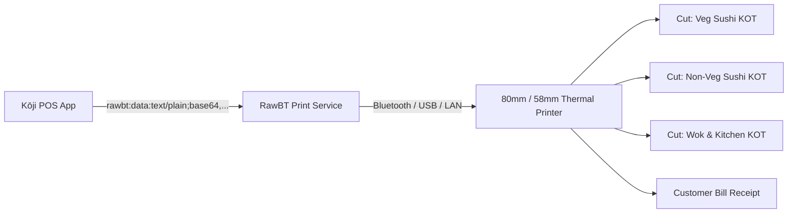
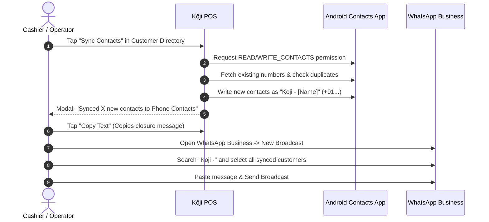

# Kōji POS (Asian Crafted Fusion)

[](https://expo.dev/)
[](https://reactnative.dev/)
[](https://www.typescriptlang.org/)
[](https://www.android.com/)
[](LICENSE)

An offline-first, high-throughput Point-of-Sale (POS) and Kitchen Display System (KDS) custom-engineered for **Kōji – Asian Crafted Fusion**, a specialty culinary food cart and kiosk brand. Built with React Native, Expo, and TypeScript, Kōji POS optimizes rush-hour kitchen workflows with station-split ESC/POS thermal printing, dynamic UPI payment QR generation, WhatsApp pickup messaging, automated phone contact syncing, and safeguards against unpaid orders.

---

## Table of Contents

- [1. Project Overview & Purpose](#1-project-overview--purpose)
  - [Domain & Target Users](#domain--target-users)
  - [Core Engineering Philosophy](#core-engineering-philosophy)
  - [Visual Design System](#visual-design-system)
- [2. Core Features & Operational Workflows](#2-core-features--operational-workflows)
  - [Point-of-Sale & Order Creation](#point-of-sale--order-creation)
  - [Queue & Kitchen Display Timeline](#queue--kitchen-display-timeline)
  - [Payment Lifecycle & Unpaid Safeguards](#payment-lifecycle--unpaid-safeguards)
  - [Thermal Receipt & Multi-Station KOT Printing](#thermal-receipt--multi-station-kot-printing)
  - [Customer Directory & Phonebook Sync](#customer-directory--phonebook-sync)
  - [WhatsApp Relay & Customer Pickup Alerts](#whatsapp-relay--customer-pickup-alerts)
  - [Admin Management Hub & Reports](#admin-management-hub--reports)
  - [Shift Rollover & Operational Safeguards](#shift-rollover--operational-safeguards)
- [3. Tech Stack & Dependencies](#3-tech-stack--dependencies)
- [4. Project Architecture & Directory Structure](#4-project-architecture--directory-structure)
  - [Directory Tree](#directory-tree)
  - [Module Responsibilities](#module-responsibilities)
- [5. Getting Started & Local Development](#5-getting-started--local-development)
  - [Prerequisites](#prerequisites)
  - [Installation & Execution](#installation--execution)
  - [Code Quality & Type Checking](#code-quality--type-checking)
  - [Building Standalone APK with EAS](#building-standalone-apk-with-eas)
- [6. Hardware & Companion Integration](#6-hardware--companion-integration)
  - [Thermal Printer Setup (RawBT)](#thermal-printer-setup-rawbt)
  - [WhatsApp Business Broadcast Workflow](#whatsapp-business-broadcast-workflow)
- [7. Author & License](#7-author--license)

---

## 1. Project Overview & Purpose

### Domain & Target Users
Kōji operates in a fast-paced food-cart and counter-service dining environment where order volume spikes heavily during peak evening hours. The terminal serves three primary roles:
1. **Cashier / Front-of-House (FOH):** Lightning-fast cart construction, dine-in/parcel/car order categorization, custom discounts, and multi-mode payment collection.
2. **Kitchen Line Chefs (Sushi, Wok, and Beverage Stations):** Real-time ticket management, FIFO queue visibility, granular item-level preparation tracking, and station-partitioned Kitchen Order Tickets (KOTs).
3. **Owner / Store Operator:** Real-time shift metrics, dynamic UPI configuration, menu pricing and stock availability, deduplicated customer directory syncing, landscape PDF/CSV audit reports, and broadcast communication.

### Core Engineering Philosophy
- **Offline-First Zero-Latency Architecture:** All transactions, active queue states, menu caches, and shift metrics persist locally on the device using `@react-native-async-storage/async-storage`. The system operates seamlessly without cloud roundtrips or internet access.
- **Zero-Extra-Taps During Rush Hour:** Critical operations (marking a dish done, checking out an order, reprinting KOTs, dispatching WhatsApp alerts) require only a single tap.
- **Hardened Revenue Safeguards:** Staff cannot inadvertently complete or dismiss an order with an outstanding balance. The UI enforces automated modal intercepts displaying exact due amounts with direct payment settlement shortcuts.
- **Continuous Native Generation (CNG):** Native configuration is driven strictly through `app.json` plugins and permissions without committing brittle manual Android build folders.

### Visual Design System
The application adheres to a centralized, high-contrast, Japanese culinary-inspired 9-token color palette located at `src/theme/colors.ts`:

| Token | Hex / Value | Semantic Role |
| :--- | :--- | :--- |
| `forest` | `#0D381E` | Primary brand identity, dark headers, primary CTAs, active pills |
| `canvas` | `#F8F9F5` | Main screen background, inset summaries, input surface fill |
| `sage` | `#EDF2EC` | Secondary card surfaces, KPI container backgrounds, avatar pills |
| `white` | `#FFFFFF` | Ticket cards, modal sheets, elevated dish components |
| `slate` | `#8C9E91` | Secondary/muted text, timestamps, subtitles, border accents |
| `border` | `#D5DFD8` | 1px dividers, card boundaries, input outlines |
| `amber` | `#D78B30` | Sequential token badges (`#01`), due balance warnings, prep notes |
| `amberTint` | `#FDF6EC` | Soft badge backgrounds, pending payment buttons, preparation chips |
| `success` | `#16A34A` | Completed status, paid badges, FSSAI Veg indicator, WhatsApp actions |
| `successTint` | `#E8F8EE` | Soft mint background for completed dishes and paid pills |
| `danger` | `#DC2626` | Cancel actions, reset triggers, FSSAI Non-Veg indicator |
| `dangerTint` | `#FDECEC` | Soft coral background for item cancellations and destructive alerts |
| `overlay` | `rgba(13, 56, 30, 0.65)` | Modal backdrop dimmed overlay |

---

## 2. Core Features & Operational Workflows

### Point-of-Sale & Order Creation
- **Visual Menu Explorer:** Category selector bar (`All`, `Sushi`, `Wok & Crisp`, `Rice & Noodles`, `Mocktail`), fast-filter search, and Veg / Non-Veg badges.
- **Cart Management:** Real-time quantity steppers with haptic feedback, custom dish preparation notes, and itemized subtotal calculations.
- **Order Types:** Instant switching between `Dine-in`, `Parcel` (Take Away), and `Car` service.
- **Order Discounts:** Support for flat rupee (`₹`) and percentage (`%`) discounts with live total recalculations.
- **Customer Information:** Optional capture of customer name and 10-digit mobile number for notification and marketing workflows.

### Queue & Kitchen Display Timeline
- **Sequential FIFO Tokens:** Automatic zero-padded token numbering (`#01`, `#02`, `#03`...) that resets daily at midnight.
- **Dish-Level Preparation Stepper:** Individual dish items track preparation status via single-tap increments (`0/1` -> `1/1 Done`).
- **Granular Item Cancellation:** Individual dishes can be cancelled mid-preparation with an optional reason note; the order subtotal and balance due adjust automatically.
- **Live Add-On Batches (`EditOrderModal`):** Seamlessly add new items or extra rolls to an existing open ticket without creating fragmented tokens. Added items are tagged as `(Add-on)` and can be printed on separate supplementary KOTs.

### Payment Lifecycle & Unpaid Safeguards
- **Multi-Method Settlements:** Full support for `UPI`, `Cash`, or split `UPI + Cash` transactions.
- **Dynamic On-Screen UPI QR Code:** Generates a real-time standard UPI Intent payload (`upi://pay?pa=...&pn=...&am=...&cu=INR`) rendered via SVG with the Kōji logo badge. Customers can scan directly from the POS tablet.
- **Unpaid Order Safeguard:** When staff tap **"Mark Done"** on an order ticket where `!order.isPaid || balanceDue > 0`, the system blocks silent completion and opens `KojiConfirmModal`:
  - Highlights exact outstanding balance (e.g., `₹240 Due`).
  - **Primary Action ("Collect Payment"):** Immediately opens the payment modal for the balance, automatically marking the order done upon receipt.
  - **Secondary Action ("Mark Done Anyway"):** Allows manager override for trusted customer accounts.
- **Edge-Case Safeguard on Final Item Completion:** Completing or cancelling the last remaining dish on a ticket evaluates total payments and intercepts with the same payment pending safeguard before concluding the order.

### Thermal Receipt & Multi-Station KOT Printing
- **RawBT Driver Protocol:** Uses Android URI schemes (`rawbt:data:text/plain;base64,...`) to stream formatted monospace ESC/POS data to Bluetooth, USB, or Network thermal printers.
- **Dual Paper Width Formatting:** Switch between 80mm (48 monospace columns) and 58mm (32 monospace columns) in Admin Settings.
- **Multi-Station KOT Partitioning:** On order submission, items are automatically segregated into station-specific KOT slips:
  1. `VEG SUSHI KOT`: Vegetarian sushi rolls and nigiri.
  2. `NON-VEG SUSHI KOT`: Seafood, chicken, and non-veg sushi rolls.
  3. `WOK & KITCHEN KOT`: Hot woks, dim sums, noodles, and beverages.
- **Hardware Auto-Cut:** Injects ESC/POS partial cut commands (`\n\n\n\x1D\x56\x42\x00`) to trigger thermal receipt printer auto-cutters (e.g., Posiflow KP307-UEWB).
- **Customer Bill Invoices:** Monospace formatted customer receipts containing token number, order type, timestamp, itemized breakdown, discounts, GST/tax lines, payment modes, and brand footer.

### Customer Directory & Phonebook Sync
- **Automated Directory Extraction:** Scans all historical orders in `AsyncStorage` to construct a deduplicated customer index keyed by normalized 10-digit mobile number.
- **VIP Customer Tracking:** Identifies frequent visitors (`>= 3 Orders`) with visual amber badges and computes total visit frequency and last visit dates.
- **1-Tap Direct Phone Contact Sync:** Utilizes `expo-contacts/legacy` to read existing device contacts and write new customers directly into the Android device's Google/phone contact storage:
  - Formats display names as `Koji - <Name>` (e.g., `Koji - Nishant`).
  - Enables instant creation of **WhatsApp Business Broadcast Lists** by simply searching for `"Koji -"`.
  - Automatically skips previously saved contacts to guarantee zero duplicates.

### WhatsApp Relay & Customer Pickup Alerts
- **Order Ready Notification:** 1-tap dispatch to WhatsApp Business (`com.whatsapp.w4b`) or standard WhatsApp:
  ```text
  Hi Nishant! 🍣 Your order (Token #04) at Kōji is freshly prepared and ready for pickup at the counter:

  - 1x Asparagus Tempura Roll
  - 1x Classic Edamame

  Best enjoyed fresh—see you at the counter!
  ```
- **Add-On Ready Notification:** Dedicated template for supplementary items added mid-session:
  ```text
  Hi Nishant! 🥢 Your added items for (Token #04) are ready for pickup at Kōji:

  - 1x Truffle Cream Cheese Roll

  Freshly rolled and ready at the counter!
  ```
- **One-Tap Holiday Closure Broadcast Relay:**
  - Individual **`Send`** / **`✓ Sent`** relay button on each customer card in the directory.
  - Pre-fills personalized closure announcement:
    ```text
    Hey Nishant! 🍣 Kōji is taking a short break and will be closed Today.
    We’ll be back rolling fresh sushi and serving your favorites from tomorrow at our usual evening hours. See you soon!
    ```
  - Tracks sent numbers in local storage for the current day, turning buttons into `✓ Sent` to prevent duplicate messaging.
  - Top card **`Copy Text`** button copies the announcement to clipboard for manual broadcasting.

### Admin Management Hub & Reports
- **Menu Management:** Real-time menu list with search, category filtering, instant stock toggle (`In Stock` / `Sold Out`), dish deletion, and default menu reset.
- **Unified Dish Creator / Editor:** Clean modal for creating or updating menu items with custom category chips, mandatory ingredients description, price in ₹, Veg / Non-Veg radio toggles, image URLs, and stock status.
- **Dynamic UPI Setup:** Set merchant VPA ID and merchant name with an instant live QR preview.
- **Order History:** Complete archive of past tickets with search and re-printing for customer bills and station KOTs.
- **Export Engine:**
  - **Landscape A4 PDF:** Generates a formatted accounting report with totals and payment breakdowns using `expo-print` and `expo-sharing`.
  - **Excel-Compatible CSV:** Generates RFC-compliant CSVs with UTF-8 BOM encoding for seamless opening in Microsoft Excel or Google Sheets.
  - Date range filters: `Today`, `7 Days`, `30 Days`, `Custom Date Range`, and `All Time`.

### Shift Rollover & Operational Safeguards
- **Automated Midnight Rollover:** An integrated background monitor verifies the last active calendar date on launch, foreground transitions, and a 30-second heartbeat. At midnight, active tokens roll back to `#01` and active order counters reset cleanly.
- **Stray FAB Suppression:** Programmatically disables stray Expo Go developer floating action buttons (`showFloatingActionButton: false`) to prevent UI obstruction on production Android tablets.

---

## 3. Tech Stack & Dependencies

| Category | Technology | Version | Purpose |
| :--- | :--- | :--- | :--- |
| **Framework** | Expo | `~58.0.26` | Managed React Native toolchain & native modules |
| **Core Runtime** | React Native | `0.88.1` | Mobile application framework |
| **UI Library** | React | `19.3.0` | Declarative component UI engine |
| **Language** | TypeScript | `~5.8` / `6.0` | Strict static typing and type safety |
| **Local Storage** | AsyncStorage | `2.2.0` | Local offline key-value persistent storage |
| **Icons** | Lucide React Native | `^1.69.0` | Crisp vector iconography |
| **QR Code Engine** | React Native SVG / QR | `15.16.0` / `6.3.54` | Dynamic UPI payment QR generation |
| **Contacts API** | Expo Contacts (Legacy) | `~58.0.11` | Android native address book read & write |
| **Clipboard** | Expo Clipboard | `~58.0.4` | System clipboard integration for broadcast messages |
| **File System** | Expo File System (Legacy) | `~58.0.14` | Local caching of PDF, CSV, and VCF exports |
| **Sharing** | Expo Sharing | `~58.0.23` | Native Android share sheet integration |
| **PDF Generation** | Expo Print | `~58.0.9` | HTML-to-PDF compilation for sales reports |
| **Haptics** | Expo Haptics | `~58.0.8` | Tactile feedback for cashier and kitchen button presses |
| **System Intents** | Expo Intent Launcher | `~58.0.3` | Deep-linking into WhatsApp Business and RawBT |
| **Screen Awakeness**| Expo Keep Awake | `~58.0.4` | Prevents kitchen display tablets from sleeping |
| **Safe Areas** | React Native Safe Area Context | `~5.11.1` | Edge-to-edge UI handling on tablets and phones |

---

## 4. Project Architecture & Directory Structure

### Directory Tree
```text
koji-pos/
├── assets/
│   ├── images/
│   │   ├── adaptive-icon.png       # Android adaptive launcher icon
│   │   ├── icon.png                # Primary application icon
│   │   └── splash-icon.png         # Splash screen asset
│   └── logo.png                    # Kōji brand circular crest logo
├── src/
│   ├── components/
│   │   ├── BrandHeader.tsx         # Top bar with logo, brand title, and action buttons
│   │   ├── CategoryBar.tsx         # Horizontal category filter pill selector
│   │   ├── CheckoutModal.tsx       # POS cart review, discount input, and checkout flow
│   │   ├── DatePickerModal.tsx     # Custom date picker for history and reports
│   │   ├── EditOrderModal.tsx      # Add live add-on dishes to existing open tickets
│   │   ├── KojiConfirmModal.tsx    # Universal styled modal dialog (amber/forest/danger)
│   │   ├── MenuItemCard.tsx        # Dish card with image, price, veg badge, and add steppers
│   │   ├── OrderTicketCard.tsx     # Kitchen ticket card with prep progress and action buttons
│   │   ├── PaymentModal.tsx        # Dynamic UPI QR, cash recording, and split settlement
│   │   ├── PrintOrderModal.tsx     # Re-print customer bills and station KOT dialog
│   │   ├── TokenBadge.tsx          # Sequential token badge component (#01, #02)
│   │   └── VegBadge.tsx            # FSSAI standard green veg / red non-veg square icon
│   ├── constants/
│   │   └── theme.ts                # Typography, font weights, and spacing metrics
│   ├── context/
│   │   └── CartContext.tsx         # Global cart state (add, increment, decrement, clear)
│   ├── data/
│   │   └── menu.json               # Seed menu data for Asian fusion dishes
│   ├── screens/
│   │   ├── AdminScreen.tsx         # Admin hub, menu manager, customer directory, reports
│   │   ├── OrderListScreen.tsx     # Live kitchen display queue and timeline
│   │   └── TakeOrderScreen.tsx     # Fast-entry POS order creation screen
│   ├── services/
│   │   ├── printService.ts         # ESC/POS monospace builder, RawBT intent dispatcher
│   │   ├── storage.ts              # AsyncStorage persistence, rollover engine, PDF/CSV reports
│   │   └── whatsappService.ts      # WhatsApp Business deep-linking and fallback SMS
│   ├── theme/
│   │   └── colors.ts               # Centralized 9-token color palette source of truth
│   └── types/
│       └── index.ts                # TypeScript interfaces, unions, and domain models
├── app.json                        # Expo CNG configuration and Android permissions
├── App.tsx                         # Root component, bottom navigation dock, rollover loop
├── eas.json                        # EAS cloud build profiles (preview, production)
├── eslint.config.js                # ESLint flat config with Expo rules
├── index.ts                        # Application entry point
├── package.json                    # Dependencies, scripts, and package metadata
├── tsconfig.json                   # TypeScript compiler configuration
└── README.md                       # Comprehensive system documentation
```

### Module Responsibilities

| File / Folder | Primary Responsibility |
| :--- | :--- |
| `src/theme/colors.ts` | Centralized 9-token design system palette (`forest`, `canvas`, `sage`, `white`, `slate`, `border`, `amber`, `success`, `danger`). |
| `src/context/CartContext.tsx` | In-memory cart state management, supporting instant additions, notes, quantity updates, and cart subtotal math. |
| `src/services/storage.ts` | Primary persistence engine for all orders, metrics, menu items, UPI configuration, customer directory extraction, and PDF/CSV report generation. |
| `src/services/printService.ts` | ESC/POS monospace receipt formatting (80mm/58mm), station KOT partitioning (Veg Sushi, Non-Veg Sushi, Wok), auto-cut injection, and RawBT intent integration. |
| `src/services/whatsappService.ts` | Android intent dispatcher for WhatsApp Business (`com.whatsapp.w4b`), standard WhatsApp (`com.whatsapp`), and fallback SMS notifications. |
| `src/screens/TakeOrderScreen.tsx` | Main POS screen allowing cashiers to select items, filter categories, search, customize, and proceed to checkout. |
| `src/screens/OrderListScreen.tsx` | Kitchen timeline display showing active tickets in FIFO sequence with dish-level preparation tracking and payment status chips. |
| `src/screens/AdminScreen.tsx` | Admin operations hub housing Menu Management, Customer Directory, Orders History, Sales Reports, UPI Setup, and Printer Preferences. |
| `src/components/KojiConfirmModal.tsx` | Standardized brand modal dialog replacing native alerts for destructive actions and payment pending rush safeguards. |
| `src/components/PaymentModal.tsx` | Multi-mode settlement modal rendering real-time dynamic UPI QR codes and handling split cash/UPI balances. |

---

## 5. Getting Started & Local Development

### Prerequisites
- **Node.js:** `v18.x` or higher (`v20.x+` recommended)
- **Package Manager:** `npm` or `bun`
- **Expo CLI:** Managed via `npx expo`
- **Development Device:** Physical Android tablet/phone or Android Studio emulator running API 30+.
- **Companion Apps (on Android device):**
  - **RawBT Print Service:** Required for sending raw ESC/POS commands to thermal receipt printers.
  - **WhatsApp Business:** Required for customer pickup alerts and broadcast relay.

### Installation & Execution

1. **Clone the repository:**
   ```bash
   git clone https://github.com/niishhh/koji-pos.git
   cd koji-pos
   ```

2. **Install dependencies:**
   > [!IMPORTANT]
   > In Expo projects, always install dependencies using `npx expo install` to resolve SDK 58-compatible package versions.
   ```bash
   npm install
   ```

3. **Start the local Expo development server:**
   ```bash
   npx expo start
   ```

4. **Run directly on connected Android device/emulator:**
   ```bash
   npx expo run:android
   ```

### Code Quality & Type Checking

Run the TypeScript compiler and Expo ESLint before submitting commits:

```bash
# Typecheck TypeScript codebase
npx tsc --noEmit

# Lint code according to Expo rules
npx expo lint

# Diagnose Expo dependencies
npx expo-doctor
```

### Building Standalone APK with EAS

The project is pre-configured with `eas.json` for Continuous Native Generation (CNG) cloud builds:

1. **Install EAS CLI:**
   ```bash
   npm install -g eas-cli
   ```

2. **Authenticate with Expo:**
   ```bash
   eas login
   ```

3. **Build Android Standalone APK (Internal Preview):**
   ```bash
   eas build --platform android --profile preview
   ```

---

## 6. Hardware & Companion Integration

### Thermal Printer Setup (RawBT)
Kōji POS uses the **RawBT Print Service** Android driver for hardware communication.



1. Install **RawBT Print Service** from the Google Play Store on the POS Android device.
2. Pair your thermal receipt printer via Bluetooth, USB OTG, or Ethernet/Wi-Fi (e.g., Posiflow, Epson, Munbyn, or generic 80mm ESC/POS printers).
3. In RawBT Settings, set:
   - **Printer Model:** Generic ESC/POS
   - **Paper Width:** 80mm (or 58mm)
   - **Character Set:** UTF-8 / Standard ASCII
4. In Kōji POS **Admin Hub -> Printer Settings**, match your paper width preference (`80mm` or `58mm`) and toggle **Auto-Print KOT on Order Placement**.

### WhatsApp Business Broadcast Workflow



---

## 7. Author & License

- **Brand:** Kōji – Asian Crafted Fusion
- **Author & Architecture:** Kōji Engineering Team ([@niishhh](https://github.com/niishhh))
- **License:** Released under the [MIT License](LICENSE).
