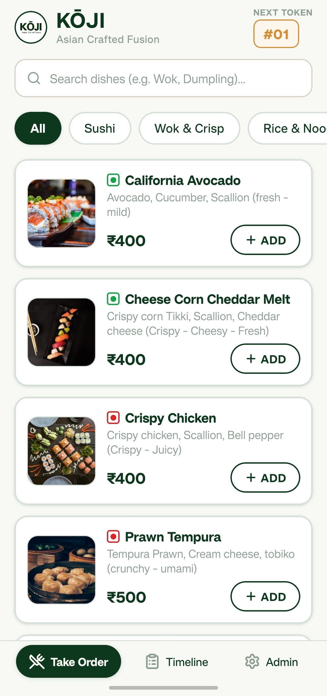
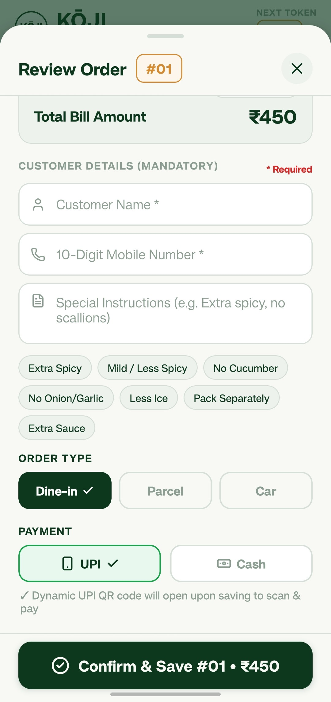
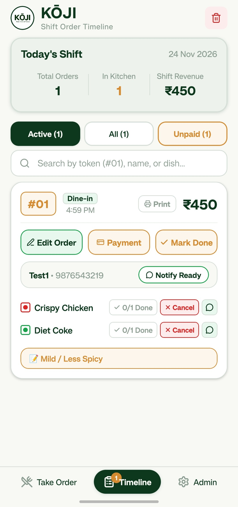
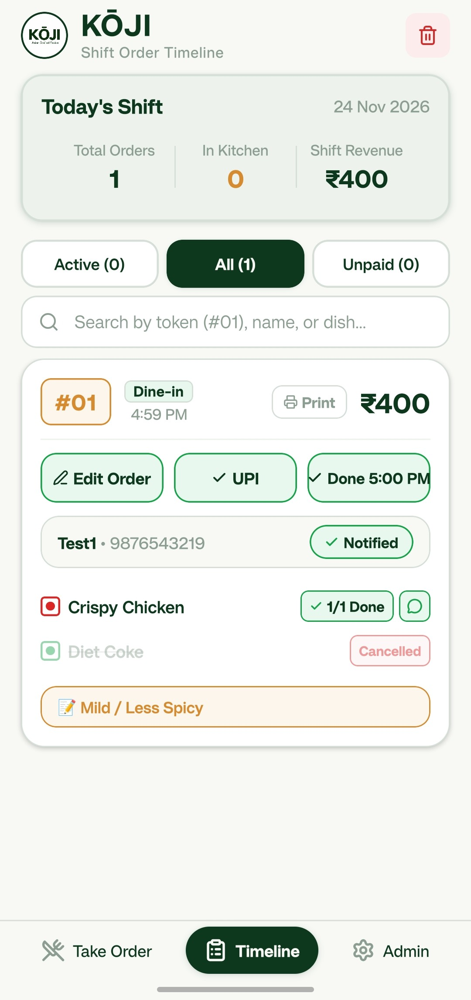
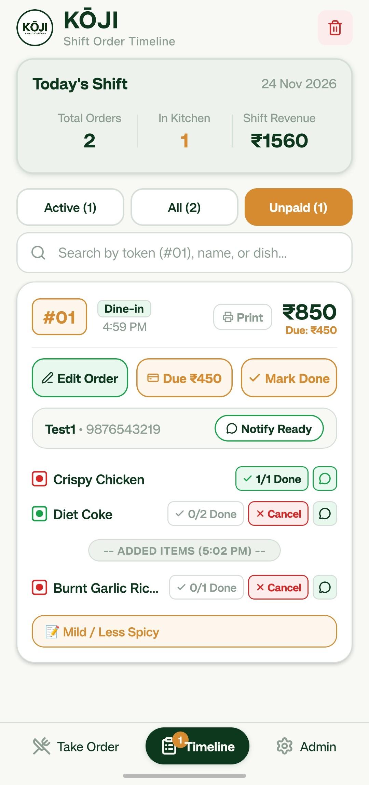
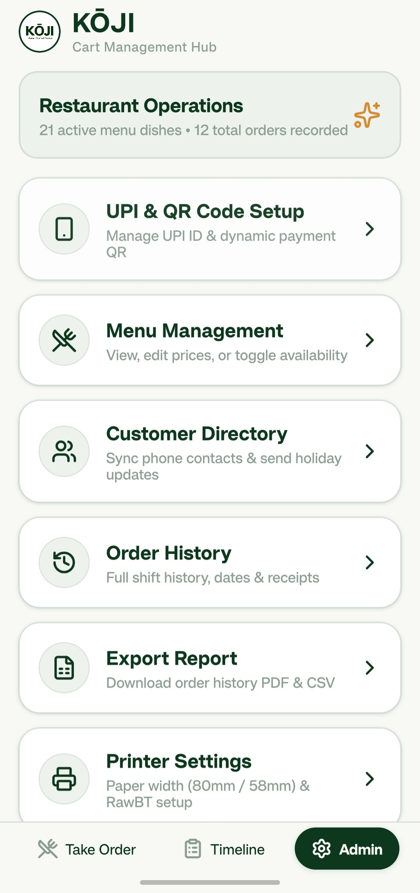
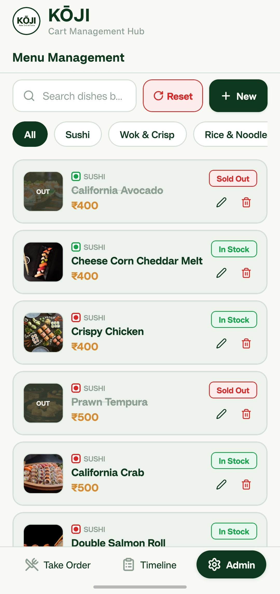
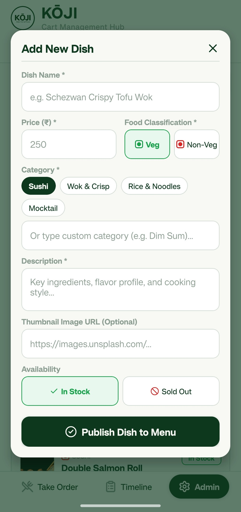
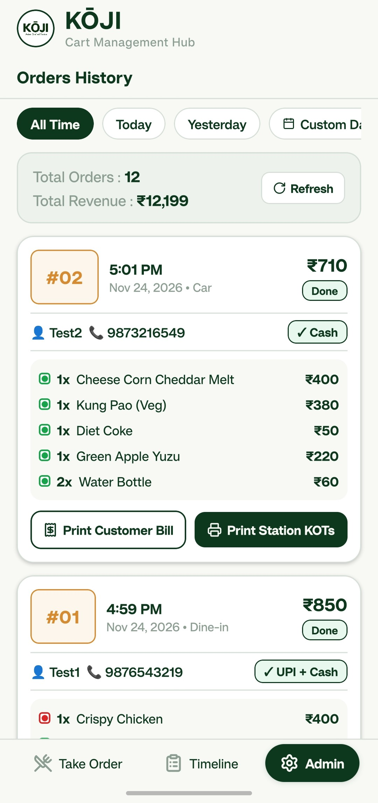
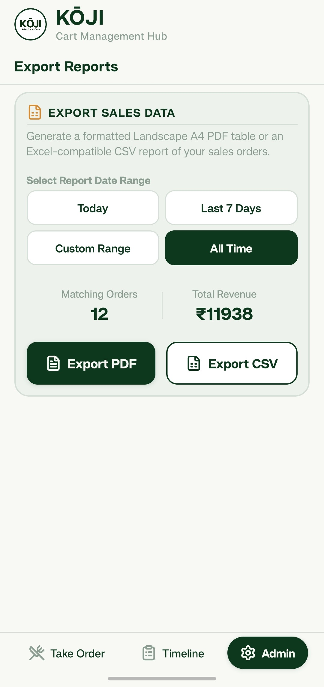

# Kōji POS - Street-Food Cart Point of Sale

[](https://expo.dev)
[](https://www.typescriptlang.org/)
[](https://react-native-async-storage.github.io/async-storage/)
[](https://rawbt.ru)

---

## 📌 Project Overview

**Kōji POS** is an offline-first mobile Point-of-Sale (POS) and Kitchen Display System (KDS) engineered specifically for **Kōji – Asian Crafted Fusion**, a high-volume street-food cart and kiosk operation. Fast-paced evening rush hours require instant order capture without network dependency, cloud latency, or cashier friction. Built with React Native and Expo SDK 58, Kōji POS maintains an instant-response catalog, continuous order sequencing, and zero-latency local persistence directly on Android tablets and handheld POS devices.

The system bridges counter sales and line cooks through an integrated FIFO visual kitchen timeline, granular dish-level progress tracking, and automated multi-station thermal KOT printing via ESC/POS. Settlements are streamlined with on-screen dynamic UPI QR code generation and cash balance safeguards, while built-in customer directory sync and WhatsApp Business integrations enable rapid order-ready pickups and customer broadcasts.

---

## 📱 Screenshots

<div align="center">
  
  
  
  
  
  
  
  
  
  
</div>

---

## 🚀 Setup Instructions

### Prerequisites

- [Node.js](https://nodejs.org/) (v18 or higher recommended) & npm
- [Expo CLI](https://docs.expo.dev/more/expo-cli/) and [EAS CLI](https://docs.expo.dev/eas/) (`npm install -g eas-cli`)
- Android device or emulator with [Expo Go](https://expo.dev/go) (or standalone preview APK build)
- **RawBT Print Service** companion app installed on the host Android device (for 80mm/58mm Bluetooth thermal printing)
- **WhatsApp Business** or WhatsApp (optional, for customer pickup alerts and broadcasts)

### Getting Started

1. **Clone the repository:**
   ```bash
   git clone https://github.com/Nisarg-13/koji-pos.git
   cd koji-pos
   ```

2. **Install project dependencies:**
   ```bash
   npm install
   ```

3. **Start the local Expo development server:**
   ```bash
   npx expo start
   ```

4. **Build Android preview APK (via EAS):**
   ```bash
   eas build -p android --profile preview
   ```
   *Alternatively, run directly on a local connected Android device with native run:*
   ```bash
   npx expo run:android
   ```

---

## ✨ Features

### 🧾 Order Entry & Rush Workflow
- **Category-Driven Menu Browsing:** Rapid filtering across Sushi, Dim Sum, Baos, Noodles & Rice, and Sides & Beverages with prominent FSSAI Veg / Non-Veg badge indicators.
- **Order Customization & Notes:** Add per-dish preparation instructions, portion quantity steppers, and customer phone/name details.
- **Dining Modes:** Instant toggle between `Dine-in`, `Parcel` (takeaway), and `Car` delivery modes with packaging surcharges where applicable.
- **Instant Billing Calculations:** Automatic subtotals, custom flat discounts, and zero-delay item add/remove interactions.

### ⏱️ FIFO Kitchen Timeline & Payment Safeguards
- **Live FIFO Kitchen Queue:** Real-time visual timeline with sequential daily token badges (`#01`, `#02`...) and rush-hour filter pills (`Active`, `Preparing`, `Ready`, `Unpaid`).
- **Granular Dish Progress:** Cooks track completion dish by dish (`0/1` -> `1/1 Done`); auto-prompts cashier when the final dish in an order is marked ready.
- **Payment Pending Safeguard:** Custom brand modal dialog (`KojiConfirmModal`) blocks completing or dispensing orders that have unpaid or outstanding balances (`₹Due`).
- **Live Order Modifications:** Append newly ordered dishes to active in-kitchen tokens with automatic add-on batch labeling and recalculations (`EditOrderModal`).

### 🖨️ Thermal Printing & Dynamic UPI QR
- **ESC/POS Thermal Printing:** High-performance monospace string builder for standard 80mm (48 columns) and 58mm (32 columns) paper rolls dispatched via Android RawBT intent.
- **Multi-Station KOT Routing:** Automatically isolates and prints split kitchen order tickets (`Veg Sushi Station`, `Non-Veg Sushi Station`, `Wok & Kitchen Station`) complete with hardware auto-cut commands.
- **Dynamic On-Screen UPI QR Code:** Generates standardized dynamic UPI payment QR codes (`react-native-qrcode-svg`) pre-encoded with merchant VPA, bill amount, and order reference.
- **Split & Cash Settlement:** Supports dual-mode settlements (`UPI + Cash`) with instant tendered cash change calculation.

### 👥 Customer Directory & Broadcast Suite
- **Deduplicated Customer Phonebook:** Automatically compiles customer profiles from active shifts and historical orders keyed by normalized 10-digit mobile numbers.
- **1-Tap Android Contacts Sync:** Integrates with `expo-contacts/legacy` to batch-sync customer contacts to the device address book with a `Koji -` prefix for WhatsApp broadcast lists.
- **WhatsApp Relay:** Direct 1-tap dispatch to WhatsApp Business for order pickup notifications and holiday closure announcements with persistent daily sent tracking.

### ⚙️ Admin Hub, Menu & Reporting
- **In-App Menu Management:** Add new dishes, edit prices, assign kitchen preparation stations, and toggle item stock availability in real time.
- **Shift & Historical Analytics:** Review daily gross sales, order volume, category velocity, and payment method breakdowns (UPI vs Cash).
- **Export Suite:** Export shift reports to Landscape A4 PDF documents (`expo-print`) or raw CSV datasets (`expo-sharing`).
- **Midnight Rollover Safeguard:** Automatically resets daily token counters back to `#01` and rolls over active orders at midnight without manual cashier intervention.

---

## 📝 Assumptions

- **Offline-First Storage:** All order queues, catalog items, and daily settings persist strictly locally on device storage via `@react-native-async-storage/async-storage` for zero dependency on cloud connectivity during service.
- **Local Device Clock Rollover:** Midnight token counter resets and shift date partitions depend on the host device's local system clock (IST).
- **RawBT Companion Driver:** ESC/POS customer receipt and multi-station KOT thermal printing rely on the Android RawBT print service app running on the host device to communicate with Bluetooth/USB printers.
- **Single-Currency Operations:** All financial calculations, UPI payment strings, and receipt layouts operate exclusively in Indian Rupees (`₹` / INR).

---

## 🏗 Architecture & Tech Stack

| Layer | Technologies Used |
| --- | --- |
| **UI & Framework** | React Native `0.88.1`, React `19.3.0`, Expo SDK `58`, `react-native-safe-area-context` |
| **Language & Tooling** | TypeScript `6.0.3`, ESLint (Expo config), Expo CLI, EAS CLI |
| **State & Persistence** | React Context API (`CartContext`), `@react-native-async-storage/async-storage` |
| **Hardware & Printing** | ESC/POS Builder, `expo-intent-launcher` (RawBT print service), `expo-keep-awake`, `expo-haptics` |
| **Payments & Vector** | `react-native-qrcode-svg`, `react-native-svg` (Dynamic UPI string generation) |
| **Contacts & Messaging** | `expo-contacts` (native phonebook sync), `expo-clipboard`, WhatsApp Business URL schemes |
| **Document & Export** | `expo-print` (Landscape A4 PDF generation), `expo-sharing` (CSV & PDF dispatch), `expo-file-system` |
| **Design System & Icons** | Centralized 9-Token Palette (`src/theme/colors.ts`), `lucide-react-native` |

---

## 📂 Project Structure

- `assets/` — Application icons, adaptive Android assets, splash screen graphics, and brand logo.
- `src/components/` — Reusable UI widgets, interactive modals (Checkout, Payment, Confirm, Edit Order, Print, Date Picker), and status badges.
- `src/constants/` — Typography scales, font weights, and spacing layout tokens (`theme.ts`).
- `src/context/` — Global cart state, item mutations, and discount calculations (`CartContext.tsx`).
- `src/data/` — Seed catalog and default Asian fusion menu items (`menu.json`).
- `src/screens/` — Primary application views: POS order entry (`TakeOrderScreen`), live kitchen queue (`OrderListScreen`), and admin management hub (`AdminScreen`).
- `src/services/` — Core business logic: ESC/POS thermal printing (`printService.ts`), AsyncStorage & report exports (`storage.ts`), and WhatsApp messaging (`whatsappService.ts`).
- `src/theme/` — Centralized 9-token color palette and semantic tokens (`colors.ts`).
- `src/types/` — TypeScript domain models, order statuses, and data contracts (`index.ts`).
- `App.tsx` — Root application component, custom bottom navigation tab dock, and midnight rollover watcher.
- `app.json` — Expo Continuous Native Generation (CNG) configuration and Android native permissions.

---

## 📄 License

This project is licensed under the [MIT License](LICENSE).
