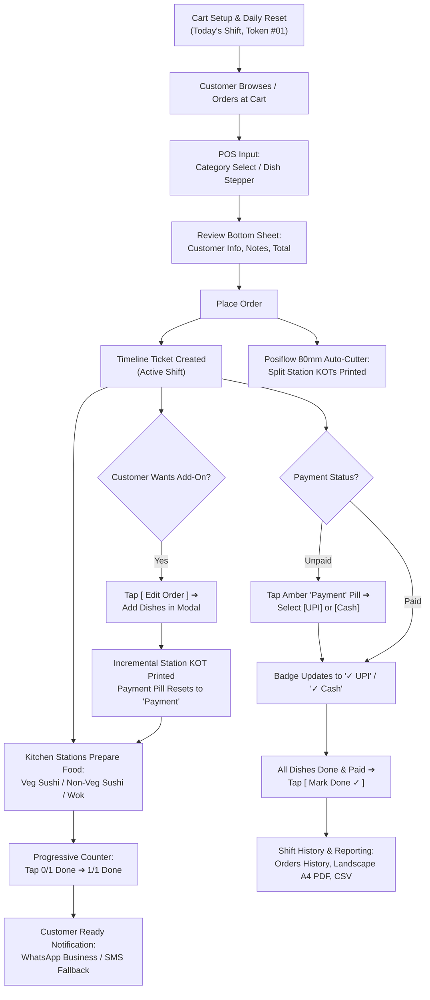

# KŌJI (糀) — Master UI/UX & Project Flow Specification Prompt
> **Document Purpose:** Complete UI/UX, Operational Architecture, and Master AI Generation Prompt for Kōji POS  
> **Platform Target:** React Native / Expo (Android Mobile Portrait — Optimized for 360dp–412dp viewports)  
> **Application Domain:** Fast-Casual Asian Fusion Food Cart Point of Sale (POS) & Kitchen Display System (KDS)  
> **Brand Identity:** Kōji — Asian Crafted Fusion  
> **Design Language:** Modern Japanese Craft Minimalism • High-Glare Sunlight Contrast • Tactical Ergonomics  

---

## PART 1: MASTER AI DESIGN & GENERATION PROMPT
*(Copy and paste the block below directly into Google Stitch, v0, Galileo AI, Claude, or Figma AI to generate or redesign the UI)*

```markdown
You are an Elite Principal Mobile UI/UX Architect and React Native Design Systems Engineer.
Design the complete, production-grade mobile UI/UX for "Kōji" (糀) — an artisanal Asian Crafted Fusion food cart POS and kitchen management mobile application designed for Android portrait smartphones operating in fast-paced, high-glare outdoor street-food environments.

### BRAND IDENTITY & VISUAL ESSENCE
- Name: Kōji (糀 / 麹) — Asian Crafted Fusion (Sushi, Wok & Crisp, Rice & Noodles, Artisanal Mocktails).
- Personality: Japanese Craft Minimalism meets High-Speed Operational Utility. Crisp, organic, tactile, and calm under high-pressure kitchen rushes.
- Palette:
  * Primary: Deep Forest Green (#0D381E) — Used for headers, active tab bars, primary actions, dark elevated cards.
  * Base Canvas: Soft Sage Off-White (#F8F9F5) — Glare-resistant outdoor canvas replacing harsh blinding white.
  * Card Surfaces: Sage Surface (#EDF2EC) — Distinct card background for order tickets and groupings.
  * Card Fills: Pure Crisp White (#FFFFFF) — Dish cards, form fields, and modal containers.
  * Accent / Highlight: Warm Amber / Gold (#D78B30) — Token badges (#01, #02), due payment callouts, batch add-on tags.
  * Muted Accent: Soft Peach/Amber (#FDF1E2 / #FEF6EB) — Background for token badges and unpaid payment pills.
  * Neutral / Borders: Laurel Green (#8C9E91) & Border Light (#D3DFD5) — Subtle borders, inactive icons, secondary text.
  * Dietary Indicators: Regulatory Indian Veg Green (#2E7D32 with #E8F5E9 fill) and Non-Veg Red (#C62828 with #FFEBEE fill).

### HARDWARE & OPERATIONAL CONSTRAINTS
- 100% Legible in Direct Sunlight: High text contrast (dark forest green #0D381E on light sage #F8F9F5). Zero low-contrast gray-on-gray text.
- One-Handed Ergonomics: Crucial interactive triggers (Cart bottom bar, quantity steppers, payment pills, modal action buttons) are within the thumb sweep zone in the bottom 60% of the screen.
- Scannability: Staff can glance at a screen from 2 feet away and instantly recognize:
  1. Token Number (#01, #02)
  2. Veg vs Non-Veg badge
  3. Payment State (Amber "Payment" vs Green "✓ UPI" / "✓ Cash")
  4. Item Done Progress ("0/1 Done" -> "1/1 Done")
- Native Navigation: Android hardware and gesture back navigation cleanly returns to the Admin Hub from any sub-screen without relying on UI back buttons.

### CORE APPLICATION SCREENS TO RENDER:
1. CART / POS SCREEN:
   - Header: Brand banner "K Ō J I - Asian Crafted Fusion" with live clock and Next Token badge.
   - Category Pills: Horizontal scroll ("All", "Sushi", "Wok & Crisp", "Rice & Noodles", "Mocktail").
   - Search Bar: Instant dish search with clear icon.
   - Dish Card Grid/List: Dish thumbnail, regulatory Veg/Non-Veg badge, bold title, culinary description, price (₹), and a high-touch quantity stepper (+ / -).
   - Sticky Bottom Floating Cart Bar: Dark forest green capsule showing total item count, order total amount, next token number, and "Review Order" chevron.
   - Cart Checkout Sheet (Slide-Up Modal): Itemized summary, customer name and phone inputs, prep notes, payment method selection, and "Place Order" button.

2. TIMELINE / LIVE KITCHEN SCREEN:
   - Shift Statistics Bar: Active tickets count, total shift orders, today's revenue.
   - Segmented Filter Control: "Active Orders" (In-progress) vs "All Orders". Strictly filtered to today's calendar shift.
   - Live Order Ticket Card:
     * Header: Warm amber Token Badge (#01), order timestamp, customer name & phone.
     * Item Rows: Veg/Non-Veg icon, item quantity & name, customer prep note badge, progressive serving counter button ("0/1 Done" -> "1/1 Done"), individual dish WhatsApp ready notification icon, item cancel button (✕).
     * Action Footer: 3-button row: [ Edit Order ] [ Payment Pill: Amber "Payment" or Green "✓ UPI"/"✓ Cash" ] [ Status: "Mark Done ✓" / "Completed" ].
   - Action Modals:
     * Payment Modal: Clean 2-button selector: [ 📱 Paid via UPI ] and [ 💵 Paid via Cash ].
     * Print Modal: Neutral outlined 2-button modal: [ Print Split Station KOTs ] and [ Print Customer Bill ].
     * Edit Order Modal: Live add-on dish editor allowing cashiers to add items to existing active tickets and trigger incremental KOT slips.

3. ADMIN OPERATIONS HUB:
   - Elevated Dark Feature Cards: Menu Management, Add New Dish, Export Reports, Orders History, UPI & QR Setup, Printer Settings, Notification Channel.
   - Fully integrated with native Android system back gesture to return to the Hub.

4. ORDERS HISTORY SCREEN:
   - Search bar (token, customer, dish, phone) & horizontal Date Filter pills (All, Today, Yesterday, Custom).
   - Daily Summary Banner: Orders count and gross revenue.
   - Historical Order Card: Left tall token badge spanning across both the Time and Date lines, right total bill (₹) and status badge, customer details, payment badge, and Print button.

5. NOTIFICATION & HARDWARE PRINT ENGINES:
   - WhatsApp Business direct intent launch (com.whatsapp.w4b) with automatic fallback to standard WhatsApp and SMS.
   - 80mm ESC/POS thermal printing with automatic station ticket cuts (Veg Sushi, Non-Veg Sushi, Wok & Kitchen) and customer receipt auto-cut.
```

---

## PART 2: END-TO-END PROJECT FLOW & OPERATIONAL LIFECYCLES



### Flow 1: Daily Shift Initialization & Token Reset
1. **Calendar Shift Boundary:** When the app opens, the Timeline and Shift Metrics filter strictly to the current calendar date (`isSameDay(order.createdAt, new Date())`).
2. **Token Reset:** Daily token numbering starts fresh at `#01`, `#02`, `#03` based on today's order count, eliminating confusion from previous shifts while preserving historical orders in `AsyncStorage`.
3. **Shift Metrics:** Live calculation of:
   * **Active Orders:** Tickets currently in preparation.
   * **Today's Total Orders:** Count of tickets placed today.
   * **Today's Revenue:** Sum of all active item sales collected via UPI and Cash.

---

### Flow 2: Menu Browsing & Order Placement (POS Screen)
1. **Category Navigation:** Cashier filters menu using horizontal pills (`All`, `Sushi`, `Wok & Crisp`, `Rice & Noodles`, `Mocktail`).
2. **Fast Search:** Live search filters by dish name or category.
3. **Dietary Verification:** Each dish prominently displays a regulatory Indian Veg (Green square & dot) or Non-Veg (Red square & triangle) badge.
4. **Item Stepper:** Tapping `+` adds the dish to the cart and reveals a numeric stepper (`-`, count, `+`).
5. **Floating Bottom Cart Capsule:** As items are added, a sticky capsule appears at the bottom with:
   * Left: Total item count badge (e.g., `3 items`).
   * Center: Total bill amount (`₹750`) and Next Token badge (`Token #04`).
   * Right: `Review Order →` button.
6. **Cart Checkout Sheet (Slide-Up Modal):**
   * Customer Name (optional / defaults to "Walk-in").
   * Customer Phone (10 digits, formatted with `+91` prefix for notifications).
   * Cooking & Preparation Notes (e.g., "No spicy mayo, extra wasabi").
   * Itemized review with quantity controls and delete buttons.
   * Total summary breakdown.
   * **"Place Order & Print KOT"** button triggers ticket creation and auto-prints station slips.

---

### Flow 3: Kitchen Display & Timeline Operations
1. **Ticket Layout:** Each order renders as an elevated Sage card (`#EDF2EC`):
   * **Header:** Warm amber Token Badge (`#01`), order elapsed time (`12m ago`), customer name and telephone.
   * **Dish Rows:** Veg/Non-veg symbol, quantity & dish name, customer prep note highlight pill.
2. **Progressive Item Done Counter:**
   * Each dish row has a stateful counter button: `0/1 Done`, `1/2 Done`, `2/2 Done`.
   * Tapping increments the counter and provides tactile haptic feedback.
   * When all portions are served, the counter highlights in soft green (`#E8F5E9`) with a checkmark (`✓ 1/1 Done`).
3. **Item Cancellation:** Tapping the red `✕` on an item opens a confirmation prompt. If confirmed, the item is crossed out with a `[Cancelled]` badge, and the ticket total recalculates automatically.
4. **Order Completion:** When all dishes are prepared and payment is settled, tapping `[ Mark Done ✓ ]` moves the ticket from "Active Orders" to completed status.

---

### Flow 4: Incremental Add-Ons & Live Order Editing
1. **Live Editing:** A customer at the counter requests an additional roll or drink. The cashier taps `[ Edit Order ]` on their active ticket.
2. **Edit Modal:** An item selector modal opens displaying current items and the full menu.
3. **Incremental Detection:**
   * Adding dishes increases the ticket total.
   * The payment status automatically resets from `Completed` back to `Pending` / `Due: ₹[amount]`, updating the middle pill back to `"Payment"`.
4. **Incremental Station KOT Printing:**
   * The POS automatically detects only the newly added items.
   * It dispatches an **Incremental Add-On KOT** to the thermal printer listing strictly the new dishes with header `*** ADD-ON KOT (Token #04) ***`, preventing kitchen duplication.

---

### Flow 5: Streamlined 2-Option Payment Flow
1. **Unpaid State:** An unpaid or partially paid ticket displays a warm amber action pill labeled `"Payment"` (`#FEF6EB` background, `#D78B30` text and border).
2. **Payment Selector Modal:** Tapping `"Payment"` opens a compact, 2-option modal:
   * **[ 📱 Paid via UPI ]**
   * **[ 💵 Paid via Cash ]**
3. **Instant Settlement:** Tapping either option:
   * Marks `paymentStatus = 'Completed'`.
   * Sets `paymentMethod = 'UPI'` or `'Cash'`.
   * Sets `amountPaid = totalAmount` (`balanceDue = 0`).
   * Updates the button label directly to `"✓ UPI"` or `"✓ Cash"` in Forest Green.
4. **Mode Switching:** Tapping `"✓ UPI"` or `"✓ Cash"` again allows toggling the payment method if cash was handed over instead.

---

### Flow 6: 80mm Posiflow KP307-UEWB Thermal Print Engine
1. **Auto-Cut Paper Separation:** Station slips and customer receipts format strictly to **80mm (48 monospace columns)** with ESC/POS hardware auto-cut codes (`\n\n\n\x1D\x56\x42\x00`).
2. **Station Separation:**
   * **Veg Sushi Station KOT:** Contains vegetarian sushi dishes.
   * **Non-Veg Sushi Station KOT:** Contains meat and seafood sushi dishes.
   * **Wok & Kitchen KOT:** Contains noodles, rice, and crisp wok dishes.
   * The printer automatically cuts between stations so slips can be dispatched to separate chef stations.
3. **Customer Receipt:** Prints clean header (`K Ō J I - Asian Crafted Fusion`), token number, itemized items with prices, total amount, and footer with hardware auto-cut.
4. **Neutral Print Action Modal:** Tapping `Print` on any ticket presents two neutral outlined options:
   * **[ 🖨️ Print Split Station KOTs ]**
   * **[ 🧾 Print Customer Bill ]**

---

### Flow 7: Direct WhatsApp Business Intent Routing & SMS Fallback
1. **Single Dish Pickup Alert:** Tapping the green message icon next to an individual dish launches a pre-formatted message:
   > *"Hi [Name]! Your 1x Salmon Truffle Roll (Token #03) is hot and ready at Kōji! Please collect it from the counter. 🍣"*
2. **Whole Order Pickup Alert:** Tapping the customer notification pill sends:
   > *"Hi [Name]! Your complete order (Token #03) is ready for pickup at Kōji! 🥢\n• 2x Prawn Tempura Roll\n• 1x Chilli Garlic Noodles\nPlease collect it from the counter!"*
3. **Incremental Add-On Ready Alert:** When new items are added to an already-notified ticket, Kōji automatically targets *only* the new items:
   > *"Hi [Name]! Your newly added items (Token #03) are ready for pickup at Kōji! 🥢\n• 1x Spicy Salmon Roll\nPlease collect them from the counter!"*
4. **Android Intent Routing:**
   * Direct launch of WhatsApp Business via package `com.whatsapp.w4b` (bypasses Android app chooser).
   * Secondary fallback to Standard WhatsApp (`com.whatsapp`).
   * Tertiary fallback to native SMS (`sms:91<phone>?body=...`) with one-tap alert prompt.
   * Admin-configurable default dispatch channel (WhatsApp Business, Standard WhatsApp, SMS Offline).

---

### Flow 8: Shift Reporting, PDF & CSV Exports
1. **Orders History:** View complete historical logs with search (token, customer, phone, dish) and quick date filter pills (`All`, `Today`, `Yesterday`, `Custom Date`).
2. **Landscape A4 PDF Export:**
   * Professional executive layout with summary revenue cards (Total Orders, UPI Revenue, Cash Revenue, Total Gross Revenue).
   * Itemized table with **Dishes Ordered** rendered one dish per line with `<br/>` tags and clean line-height.
   * Direct Base64 write to bypass Android scoped storage permission boundaries.
3. **Excel CSV Export:** Single-line pipe-delimited format (` | `) with formula-safe phone formatting.

---

## PART 3: DETAILED UI/UX COMPONENT ARCHITECTURE

### 3.1 Global Visual Design Tokens (`theme.ts`)

| Category | Token | Value | Visual Purpose |
| :--- | :--- | :--- | :--- |
| **Colors** | `COLORS.forestGreen` | `#0D381E` | Primary brand green, headers, primary buttons, borders |
| | `COLORS.cream` / `ivory` | `#F8F9F5` | Main screen canvas background (anti-glare) |
| | `COLORS.sage` | `#EDF2EC` | Ticket card surface, subtle button containers |
| | `COLORS.white` | `#FFFFFF` | Menu dish cards, modal sheets, popup surfaces |
| | `COLORS.amber` / `apricot` | `#D78B30` | Token badges, unpaid payment pill, active accents |
| | `COLORS.amberBg` | `#FDF1E2` / `#FEF6EB` | Token badge fill, pending payment pill background |
| | `COLORS.laurel` / `natural`| `#8C9E91` | Muted secondary text, subtle card borders (`#D5DFD8`) |
| | `COLORS.veg` | `#2E7D32` | Regulatory vegetarian indicator, completed status |
| | `COLORS.vegBg` | `#E8F5E9` | Completed item highlight background |
| | `COLORS.nonVeg` | `#C62828` | Regulatory non-vegetarian indicator |
| | `COLORS.nonVegBg` | `#FFEBEE` | Non-veg background tint |
| | `COLORS.danger` | `#D32F2F` | Cancellation red, destructive actions |
| **Typography**| `FONTS.heavy` | Weight `800` | Token numbers, brand headers, total prices |
| | `FONTS.bold` | Weight `700` | Section titles, dish names, button labels |
| | `FONTS.medium` | Weight `500` | Timestamps, customer names, secondary badges |
| | `FONTS.regular` | Weight `400` | Culinary descriptions, item details, helper notes |
| **Radii** | Compact | `6dp – 8dp` | Action pills (`Payment`, `Edit Order`), Token badge |
| | Medium | `12dp – 14dp`| Dish card thumbnails, search bars, print buttons |
| | Large Card | `16dp – 18dp`| Order tickets, elevated admin cards |
| | Sheet / Modal | `22dp – 24dp`| Bottom sheets, dialog popups, top navigation pills |
| | Full Pill | `999dp` | Status badges, category filter pills |

---

### 3.2 Screen-by-Screen UI Blueprint

#### Screen 1: Cart POS (`POSScreen.tsx`)
```
+-------------------------------------------------------------+
|  [ K Ō J I ]  Asian Crafted Fusion        🕒 1:45 PM       |
|  Counter POS • Shift: Active            Token: NEXT #04    |
+-------------------------------------------------------------+
| [ All ] [ Sushi ] [ Wok & Crisp ] [ Rice & Noodles ] [ Drink] |
+-------------------------------------------------------------+
| 🔍 Search dish by name or category...                       |
+-------------------------------------------------------------+
|  +-------+  [🟢 VEG]  Truffle Avocado Roll                  |
|  | Image |  Creamy avocado, black truffle mayo, crisp tanuki |
|  |  [ ]  |  ₹380                                            |
|  +-------+  [ - ]   2   [ + ]                               |
+-------------------------------------------------------------+
|  +-------+  [🔴 NON-VEG]  Spicy Prawn Tempura Roll          |
|  | Image |  Crispy tiger prawn, spicy sriracha glaze, tobiko|
|  |  [ ]  |  ₹450                                            |
|  +-------+  [       + ADD       ]                           |
+-------------------------------------------------------------+
|                                                             |
|  =========================================================  |
|  [ 🛍️ 2 Items • ₹780 ]      [ NEXT #04 ]     [ Review → ]   |
|  =========================================================  |
+-------------------------------------------------------------+
```

#### Screen 2: Timeline Live Kitchen (`OrderListScreen.tsx`)
```
+-------------------------------------------------------------+
|  SHIFT STATS: 3 Active  •  18 Total Orders  •  ₹8,450 Today  |
|  [ Active Orders (3) ]             [ All Today's Orders ]   |
+-------------------------------------------------------------+
| +---------------------------------------------------------+ |
| |  [ #04 ]  1:42 PM (3m ago)         ₹780       [PREPARING] |
| |  👤 Rahul Sharma  📞 9876543210                           |
| |  -----------------------------------------------------  | |
| |  🟢 1x Truffle Avocado Roll          [ 1/1 Done ✓ ] 💬 ✕ | |
| |     ↳ Note: "Extra pickled ginger on side"              | |
| |  🔴 1x Spicy Prawn Tempura Roll      [ 0/1 Done   ] 💬 ✕ | |
| |  -----------------------------------------------------  | |
| |  [ Edit Order ]     [ Payment ]           [ Mark Done ✓ ]| |
| +---------------------------------------------------------+ |
+-------------------------------------------------------------+
```

#### Screen 3: Orders History Screen (`AdminScreen.tsx -> all_orders`)
```
+-------------------------------------------------------------+
|  ORDERS HISTORY (Today: 18 Orders • ₹8,450 Revenue)         |
|  🔍 Search token, customer, phone, dish...                  |
|  [ All ] [ Today ] [ Yesterday ] [ 📅 Custom Date ]         |
+-------------------------------------------------------------+
| +---------------------------------------------------------+ |
| | +--------+  1:42 PM                       ₹780          | |
| | |  #04   |  Nov 20, 2026                 [ Done ]       | |
| | +--------+                                              | |
| | 👤 Rahul Sharma  📞 9876543210           [ ✓ UPI ]      | |
| | • 1x Truffle Avocado Roll (₹380)                        | |
| | • 1x Spicy Prawn Tempura Roll (₹400)                    | |
| | [ 🖨️ Re-Print Receipt / Station KOT ]                   | |
| +---------------------------------------------------------+ |
+-------------------------------------------------------------+
```

#### Screen 4: Streamlined Modals (`PrintOrderModal` & `PaymentModal`)
```
     PAYMENT SELECTION MODAL              PRINT ACTION MODAL
+-------------------------------+  +-------------------------------+
|       Confirm Payment         |  |      Print Station Slips      |
|    Token #04  •  Total ₹780   |  |      Thermal 80mm Posiflow    |
| Select customer payment mode: |  | Active Stations: 2            |
|                               |  |                               |
| +---------------------------+ |  | +---------------------------+ |
| |      📱 Paid via UPI      | |  | | 🖨️ Print Split KOTs (2)   | |
| +---------------------------+ |  | |   Auto-cut station slips  | |
|                               |  | +---------------------------+ |
| +---------------------------+ |  |                               |
| |      💵 Paid via Cash     | |  | +---------------------------+ |
| +---------------------------+ |  | | 🧾 Print Customer Bill    | |
| +---------------------------+ |  | |   Itemized receipt        | |
|                               |  | +---------------------------+ |
+-------------------------------+  +-------------------------------+
```

---

## PART 4: OPERATIONAL SPECIFICATION SUMMARY

1. **State Persistence:** All order states, metrics, menu catalog, UPI configs, printer preferences, and notification channels persist locally in React Native `AsyncStorage`. No cloud outage can halt the food cart.
2. **Thermal Driver:** Uses standard RawBT deep linking (`rawbt:data:text/plain;base64,...`) with ESC/POS hardware auto-cut codes (`\x1D\x56\x42\x00`) to Posiflow KP307-UEWB 80mm printers.
3. **Intent System:** Uses `expo-intent-launcher` on Android (`android.intent.action.VIEW` targeting `com.whatsapp.w4b`) for instant WhatsApp Business customer notifications without triggering Android system app-picker popups.
4. **Export Engine:** Uses `expo-print` with `base64: true` and `expo-file-system` document directory persistence to ensure Android 10+ scoped storage permission compliance for PDF reports.
